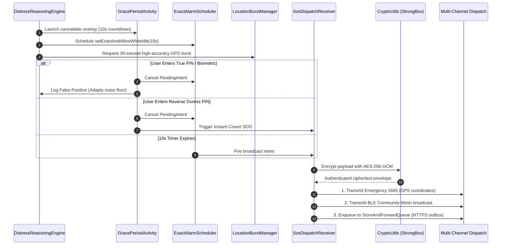

# AcousticGuard

On-device, autonomous Android background engine engineered to detect involuntary physiological acoustic distress markers—including high-frequency vocal tract friction (screams), respiratory stridor (hyperventilation and agonal gasping), and blunt impact transients (physical struggle)—without requiring manual user interaction.

---

## Abstract & Operational Context

In acute physical danger—such as violent assault, domestic violence, abduction, respiratory collapse, or physical restraint—victims are frequently prevented from interacting with a smartphone. Conventional safety applications fail in these life-or-death windows because they rely on manual touch triggers, multi-step navigation, or voice assistant keywords ("Hey Google", "Hey Siri") that cannot be spoken when muffled, gagged, or suffering psychological paralysis.

AcousticGuard addresses this systemic vulnerability through zero-touch, on-device acoustic biomarker surveillance. The system executes continuous, energy-efficient signal processing and neural inference entirely in volatile RAM, correlating acoustic anomalies with inertial motion sensors to coordinate an encrypted, offline-resilient emergency dispatch.

The engine operates on a strict fail-closed, zero-retention paradigm: raw audio is never written to flash storage, never transmitted off the device, and never logged.

---

## Architectural Specification

AcousticGuard isolates system responsibilities across two distinct Android operating system processes to maximize detection continuity and prevent UI or WebView crashes from terminating the background sentinel.

```text
+-------------------------------------------------------------------------+
| Visible Application Process (:default)                                  |
|                                                                         |
|  +-----------------------------+     +-------------------------------+  |
|  | WatchdogService             |     | Android WebView Host          |  |
|  | - Process liveness monitor  |<--->| - 32-Bar FFT visualizer       |  |
|  | - IPC Messenger heartbeat   |     | - Liquid glass design system  |  |
|  | - Crash recovery supervisor |     | - AndroidBridge JS interface  |  |
|  +-----------------------------+     +-------------------------------+  |
+---------------------------------------------------|---------------------+
                                                    | Binder IPC
+---------------------------------------------------|---------------------+
| Background Capture Process (:remote)              v                     |
|                                                                         |
|  +-------------------------------------------------------------------+  |
|  | AcousticCaptureService (Foreground Service: MICROPHONE)          |  |
|  |                                                                   |  |
|  |  [Audio Capture Pipeline]                                         |  |
|  |  - AudioRecord / AAudio Native JNI (16 kHz, Mono, 16-bit PCM)      |  |
|  |  - Volatile CircularPcmBuffer (16,000 samples, RAM-only ring)     |  |
|  |  - Ephemeral frame sliding window (500 ms evaluation cadence)     |  |
|  |                                                                   |  |
|  |  [Tier 1: Physiological DSP Analyzer]                             |  |
|  |  - SpectralAnalyzer: 512-point Hann FFT, HF friction ratio        |  |
|  |  - RespiratoryPeriodicityDetector: Autocorrelation (1.5-2.5 Hz)   |  |
|  |  - ImpactTransientDetector: 5 ms / 10 ms RMS attack & crest factor|  |
|  |  - AdaptiveNoiseProfile: Continuous ambient noise floor tracking  |  |
|  |  - MotionSensorFusion: Accelerometer + gyroscope shock fusion     |  |
|  |                                                                   |  |
|  |  [Tier 2: Neural TFLite Classifier]                               |  |
|  |  - distress_multilingual.tflite (16 calibrated target classes)    |  |
|  |  - Input: FLOAT32 [1, 16000] | Output: FLOAT32 [1, 16] probabilities|
|  |  - Zero-allocation direct off-heap native ByteBuffers             |  |
|  |                                                                   |  |
|  |  [Distress Reasoning Engine & Policy Guard]                       |  |
|  |  - Multilingual taxonomy mapping (10 Indian languages + English)  |  |
|  |  - Owner Voice Profile matching (suppresses benign speech only)   |  |
|  |  - Rapid escalation policy (single-window acute fast-track)       |  |
|  |                                                                   |  |
|  |  [Emergency Escalation Boundary]                                  |  |
|  |  - GracePeriodActivity: 10s cancelable countdown + haptics        |  |
|  |  - Reverse Duress PIN verification (instant covert dispatch)      |  |
|  |  - Doze-exempt AlarmManager.setExactAndAllowWhileIdle()           |  |
|  +-------------------------------------------------------------------+  |
+---------------------------------------------------|---------------------+
                                                    | Exact Alarm / Intent
+---------------------------------------------------|---------------------+
| Emergency Dispatch Subsystem                      v                     |
|                                                                         |
|  +-------------------------------------------------------------------+  |
|  | SosDispatchReceiver                                               |  |
|  | - LocationBurstManager: 30-second high-accuracy GPS fix           |  |
|  | - AES-256-GCM authenticated encryption (Android Keystore/StrongBox)|  |
|  | - Cellular SMS dispatch with emergency coordinates                |  |
|  | - CommunityMesh: BLE peer-to-peer offline broadcast relay         |  |
|  | - StoreAndForwardQueue: Durable HTTPS outbox with backoff retry   |  |
|  +-------------------------------------------------------------------+  |
+-------------------------------------------------------------------------+
```

---

## Tier 1: Deterministic Physiological DSP Pipeline

Running deep neural networks continuously on audio streams drains battery within hours and generates excessive thermal dissipation. AcousticGuard solves this by decoupling feature detection into a two-tier cascade: Tier 1 executes pure, deterministic DSP algorithms every 500 ms; Tier 2 (TensorFlow Lite neural inference) is activated only when Tier 1 detects anomalous energy patterns.

### 1. High-Frequency Vocal Friction Ratio (`SpectralAnalyzer`)

Human screaming is distinguished from speech formants by turbulent air friction across strained vocal folds, generating substantial harmonic distortion between 3.5 kHz and 8.0 kHz. Normal human conversational vowels peak below 3.0 kHz.

Every 500 ms frame (8,000 samples at 16 kHz), a 512-point Hann-window Fast Fourier Transform is evaluated across overlapping sub-windows:

```text
w[n] = 0.5 * (1 - cos(2 * pi * n / (N - 1)))
X[k] = Sum_{n=0}^{N-1} (x[n] * w[n] * exp(-j * 2 * pi * k * n / N))
```

The spectral friction ratio is defined as:

```text
FrictionRatio = Energy(3500 Hz to 8000 Hz) / TotalEnergy(0 Hz to 8000 Hz)
```

A frame is flagged as a vocal friction candidate when:
* Total RMS amplitude exceeds the adaptive ambient noise floor by at least 15 dB;
* `FrictionRatio` exceeds the dynamic threshold (nominally 0.38, adapted dynamically against continuous background noise).

### 2. Respiratory Periodicity Autocorrelation (`RespiratoryPeriodicityDetector`)

Hyperventilation, severe respiratory distress, and agonal breathing exhibit distinct low-frequency periodic energy envelopes (1.5 Hz to 2.5 Hz, corresponding to 90 to 150 breaths per minute).

1. Frame RMS energy is downsampled into a scalar envelope buffer sampled at 10 Hz over a 16-second sliding history (160 scalar points).
2. The normalized autocorrelation function is computed across lags tau corresponding to periods between 0.4 seconds and 1.2 seconds:

```text
R(tau) = (Sum_{t} (E[t] - mean(E)) * (E[t + tau] - mean(E))) / Var(E)
```

3. If peak autocorrelation `R(tau_peak) >= 0.65` within the 1.5 Hz to 2.5 Hz window, the signal is classified as candidate respiratory distress.

### 3. Impact Transient Crest Factor (`ImpactTransientDetector`)

Physical struggles, domestic violence, and falls generate sudden, non-harmonic, high-energy impact transients.

* **Attack Slope**: Evaluated over 5 ms and 10 ms sub-windows:
  ```text
  AttackSlope = (RMS_current_5ms - RMS_preceding_5ms) / delta_t
  ```
* **Crest Factor**: Ratio of peak instantaneous amplitude to frame RMS:
  ```text
  CrestFactor_dB = 20 * log10(abs(x_peak) / RMS_frame)
  ```
* An impact event is confirmed when `CrestFactor_dB > 14.0 dB`, `AttackSlope` exceeds 4.5x baseline, and frame boundary clipping occurs without sustained harmonic resonance.

### 4. Dynamic Noise Floor Tracking (`AdaptiveNoiseProfile`)

To maintain stability across varying ambient environments (e.g., quiet bedrooms vs. subway platforms), an exponential moving average tracks the baseline noise floor:

```text
Floor_{t} = (1 - alpha) * Floor_{t-1} + alpha * FrameEnergy
```

Updating occurs exclusively during non-candidate frames (`alpha = 0.05`). When a candidate event occurs, updates freeze immediately to preserve the pre-event baseline.

---

## Tier 2: Neural TFLite Classifier & Model Contracts

When Tier 1 DSP flags an anomaly, the volatile 1.0-second PCM buffer is dispatched to the TensorFlow Lite inference engine.

### Tensor Contract Specification

| Parameter | Input Tensor `[0]` | Output Tensor `[0]` |
|---|---|---|
| Data Type | `FLOAT32`, `INT8`, or `UINT8` | `FLOAT32`, `INT8`, or `UINT8` |
| Dimensions | `[1, 16000]` | `[1, 16]` |
| Sample Rate | 16,000 Hz, single channel (Mono) | 16 discrete probability values |
| Normalization | Audio normalized to `[-1.0, 1.0]` | Calibrated Softmax sum = 1.0 |
| Memory Mode | Direct off-heap `ByteBuffer` | Direct off-heap `ByteBuffer` |

### Label Taxonomy (16 Classes)

Target classes defined in `app/src/main/assets/distress_multilingual_labels.txt`:

| Index | Label Key | Target Acoustic Biomarker | Category |
|---|---|---|---|
| 0 | `background` | Ambient silence, HVAC, street noise, room tone | Benign Ambient |
| 1 | `speech` | Conversational speech, laughter, non-distress voice | Benign Vocal |
| 2 | `screaming_vocal_friction` | Acute vocal cord friction, panic scream, shriek | Physiological Distress |
| 3 | `hyperventilation_gasp` | Rapid tachypnea breath cycle, panic gasp | Physiological Distress |
| 4 | `physical_struggle_thud` | Blunt body impact, floor impact, struggle shock | Physical Violence |
| 5 | `physical_restraint_groan` | Compressed vocalization under physical force | Physical Violence |
| 6 | `suffocation_stridor` | High-pitched airway obstruction, choking, wheeze | Physiological Distress |
| 7 | `distress` | Composite unclassified distress vocalization | General Distress |
| 8 | `help` | Spoken English distress keyword | Spoken Keyword |
| 9 | `help me` | Spoken English emergency compound phrase | Spoken Keyword |
| 10 | `madad` | Hindi distress transliteration ("madad") | Spoken Keyword |
| 11 | `मदद` | Hindi distress keyword in Devanagari script | Spoken Keyword |
| 12 | `bachao` | Hindi distress transliteration ("bachao") | Spoken Keyword |
| 13 | `बचाओ` | Hindi emergency cry in Devanagari script | Spoken Keyword |
| 14 | `sahayata` | Formal Hindi distress transliteration | Spoken Keyword |
| 15 | `सहायता` | Formal Hindi emergency keyword in Devanagari | Spoken Keyword |

### Multilingual Taxonomy Mapping (`DistressLabelTaxonomy`)

The classification engine maps target predictions against phonetic and script aliases across 10 major Indian languages:

* **Hindi**: मदद, बचाओ, सहायता
* **Bengali**: সাহায্য (Sahajjo), বাঁচাও (Bachao)
* **Tamil**: உதவி (Udhavi), காப்பாற்றுங்கள் (Kaappatrungal)
* **Telugu**: సహాయం (Sahayam), కాపాడండి (Kapadandi)
* **Kannada**: ಸಹಾಯ (Sahaya), ಉಳಿಸಿ (Ulisi)
* **Malayalam**: സഹായം (Sahayam), രക്ഷിക്കൂ (Rakshikku)
* **Marathi**: मदत (Madat), वाचवा (Vachva)
* **Gujarati**: મદદ (Madad), બચાવો (Bachavo)
* **Punjabi**: ਮਦਦ (Madad), ਬਚਾਓ (Bachao)
* **Urdu**: مدد (Madad), بچاؤ (Bachao)

---

## Reasoning Engine & Escalation Policy

`DistressReasoningEngine` acts as an immutable safety and policy boundary above raw neural probabilities. It prevents false triggers from transient environmental noises while guaranteeing rapid escalation under acute trauma.

```text
+-------------------+
| Audio Buffer In   |
+---------+---------+
          |
          v
+-------------------+      No
| Tier 1 DSP Anomaly? |-------------> [Drop Frame / Update Noise Floor]
+---------+---------+
          | Yes
          v
+-------------------+
| TFLite Inference  |
+---------+---------+
          |
          +--------------------------------------------------------+
          |                                                        |
          v                                                        v
[Standard Path]                                          [Rapid Probe Fast-Track]
- Target Confidence >= 0.82                              - Explicit Keyword >= 0.90 OR
- Requires 2 consecutive frames (1500 ms)                 - Acute Scream >= 0.95 OR
- Co-occurring friction + stridor: 750 ms                 - Impact + Accelerometer Spike
          |                                                        |
          +---------------------------+----------------------------+
                                      |
                                      v
                        +---------------------------+
                        | Owner Voice Suppression?  |
                        +-------------+-------------+
                                      |
              +-----------------------+-----------------------+
              | Matches Owner                                 | Does Not Match
              v                                               v
    [Check Safety Invariant]                     [Initiate Emergency Escalation]
    - Benign speech? -> Suppressed               - Launch GracePeriodActivity (10s)
    - Scream / Impact / Keyword? -> NOT          - Schedule ExactAlarm (Doze-safe)
      suppressible. Escalation proceeds.         - Engage Location Burst GPS
```

### Safety Invariants

1. **Non-Overridable Distress**: Owner voice matching is strictly authorized to suppress calibrated `BENIGN_SPEECH`. An owner voice match is categorically prohibited from suppressing screams, impact transients, explicit help cries, or motion-correlated impacts.
2. **Rapid Escalation Boundary**:
   * `RAPID_KEYWORD_THRESHOLD = 0.90`: Immediate alert authorization on single-frame detection of confirmed help cries.
   * `SINGLE_WINDOW_DISTRESS_THRESHOLD = 0.95`: Acute shrieks and screams bypass multi-frame smoothing.
   * `STRONG_IMPACT_WITH_MOTION`: Acoustic transient coincident with accelerometer shock $> 2.8g$ and gyroscope angular velocity $> 4.0\text{ rad/s}$ authorizes single-window escalation.

---

## Threat Model & Adversarial Mitigations

| Threat Vector | Attack Scenario | AcousticGuard Defense |
|---|---|---|
| **Forced Cancellation** | Attacker forces victim at knifepoint or gunpoint to unlock device and cancel alert. | **Covert Reverse Duress PIN**: Entering reverse PIN (e.g., `4321` for PIN `1234`) visually mimics a successful cancellation while silently transmitting an instant duress broadcast. |
| **Network Deprivation** | Attacker disables mobile data, enables Airplane Mode, or operates in a subterranean/shielded venue. | **Dual-Path Mesh & Queue**: Broadcasts unencrypted/pre-shared BLE mesh beacons to nearby nodes (`CommunityMesh`) and stores encrypted envelopes in a durable, bounded queue (`StoreAndForwardQueue`) that flushes on connectivity restoration. |
| **Forensic Seizure** | Attacker or adversary seizes device and inspects flash memory or file system to extract audio recordings. | **Zero-Flash-Retention**: Audio samples reside strictly in a volatile, bounded, direct-memory ring buffer (`CircularPcmBuffer`) overwritten every 1,000 ms. Zero bytes of audio are ever written to flash storage. |
| **OS Memory Termination** | Android low-memory killer (LMK) kills background monitoring process during memory pressure. | **Dual-Process Architecture + Watchdog**: Dedicated `:remote` capture process runs under `FOREGROUND_SERVICE_MICROPHONE`. Main `:default` process runs `WatchdogService` connected via IPC Messenger to automatically restart capture if killed. |
| **Deep Sleep / Doze Inaction** | Device enters Android Doze mode, suspending background threads and network access. | **Doze-Exempt Exact Alarms**: `ExactAlarmScheduler` binds to `AlarmManager.setExactAndAllowWhileIdle()`, guaranteeing that countdown evaluation and emergency dispatch execute on time even during deep Doze. |

---

## Offline Resilient Emergency Dispatch

Upon distress validation, AcousticGuard activates an offline-resilient, defense-in-depth dispatch sequence:



### Dispatch Channels

1. **Cellular SMS Relay**: Transmits un-throttled SMS messages containing UTC timestamps, event UUID, and Google Maps latitude/longitude links directly to the user's pre-configured Trusted Circle.
2. **BLE Community Mesh (`CommunityMesh`)**: Transmits rotating encrypted BLE advertisement packets containing the distressed device's cryptographic identity, allowing nearby phones running AcousticGuard to relay the distress signal even when the primary device has no cellular coverage.
3. **Encrypted Store-and-Forward Outbox (`StoreAndForwardQueue`)**: Bounded FIFO storage (maximum 64 encrypted envelopes) secured with `AES/GCM/NoPadding` keys stored in Android Keystore / StrongBox. Envelopes automatically flush with exponential backoff whenever network connectivity is re-established via `SosNetworkFlushBoundary`.

---

## Audible and Near-Ultrasonic Transmission Policy

AcousticGuard does not enable an audible or near-ultrasonic SOS transmission channel by default. An emitted tone could be heard or felt by nearby people, could disturb children, animals, or hearing-sensitive users, could be mistaken for an emergency signal, and would add a privacy-sensitive outbound channel without guaranteeing authentication, reception, or emergency-service delivery. The detector also must not turn a user's microphone permission into permission to broadcast. Any future tone channel therefore requires a separate, visible opt-in with informed consent, a documented frequency/power/duration policy, local compatibility and hearing-safety review, and an explicit cancellation path. This slice intentionally implements no ultrasonic audio transmission.

---

## User Interface & Design System

The application interface is delivered as a lightweight, GPU-accelerated web application hosted inside an Android WebView, communicating bidirectionally with the native Android runtime via `AndroidBridge`:

* **Liquid Glass Design System**: Implemented in `app/src/main/assets/web/css/design-system.css`, utilizing Apple-grade glassmorphic surface materials (`backdrop-filter: blur(40px)`), dynamic depth hierarchies, and high-contrast obsidian (`#07090e`) and pearl themes.
* **32-Bar Real-Time Audio Visualizer**: Evaluates live decibel telemetry streamed from `AcousticCaptureService` via `AndroidBridge.onAudioLevel(rmsDb)`. Uses spring physics interpolation and circular radar sweep glow to render real-time frequency distribution without UI thread jitter.
* **Contextual Morphing Sentinel States**:
  * `IDLE`: Ambient relaxation state, low-contrast shield, paused telemetry.
  * `MONITORING`: Subtle gold pulse, active decibel needle, continuous acoustic monitoring.
  * `CANDIDATE`: Warm amber luminescence with accelerated rhythm upon energy threshold breaches.
  * `PRE_ALERT`: Urgent ruby chromatic glow during distress confirmation countdown.
* **Accessibility & Performance**: Fully supports `prefers-reduced-motion` to tone down spring physics and pulsating glows for vestibular sensitivities.
* **Modular Codebase Structure**:
  * `web/css/design-system.css`: Design tokens, typography variables, glass layers, and keyframes.
  * `web/css/components.css`: Buttons, sliders, switches, modal overlays, and visualizer canvas.
  * `web/css/pages.css`: Haven Sentinel (monitoring tab) and Citadel Settings (configuration tab).
  * `web/js/bridge.js`: Defensive typed wrapper for `@JavascriptInterface AndroidBridge`.
  * `web/js/navigation.js`: Fluid tab navigation with keyboard focus traps for modals.
  * `web/js/dashboard.js`: 32-bar spectrum loop, real-time sensor fusion display, and live event log.
  * `web/js/settings.js`: Safety circle contacts, sensitivity sliders, and duress PIN keypad.

---

## Repository Layout & Component Architecture


```text
acousticguard/
├── app/
│   ├── build.gradle.kts                # Gradle build script (TFLite noCompress, JNI scaffold)
│   ├── proguard-rules.pro              # R8 shrinking and JNI preservation rules
│   └── src/
│       ├── main/
│       │   ├── AndroidManifest.xml     # Dual-process declarations & FGS permissions
│       │   ├── assets/
│       │   │   ├── distress_multilingual_labels.txt # 16-class label taxonomy
│       │   │   ├── distress_multilingual.tflite     # Tier 2 neural classifier
│       │   │   ├── owner_voice_embedding.tflite     # 64-dim speaker embedding model
│       │   │   └── web/                             # Modular WebView user interface
│       │   │       ├── index.html                   # Semantic HTML shell
│       │   │       ├── css/
│       │   │       │   ├── design-system.css        # Tokens, blur surfaces, obsidian theme
│       │   │       │   ├── components.css           # Switch, sliders, visualizer canvas
│       │   │       │   └── pages.css                # Haven Sentinel & Citadel Settings tabs
│       │   │       └── js/
│       │   │           ├── bridge.js                # AndroidBridge native JS interface
│       │   │           ├── navigation.js            # Tab switching & focus management
│       │   │           ├── dashboard.js             # 32-bar visualizer & real-time telemetry
│       │   │           └── settings.js              # Sensitivity sliders & duress PIN pad
│       │   ├── cpp/
│       │   │   ├── CMakeLists.txt              # CMake configuration for libacousticguard_audio
│       │   │   └── acousticguard_audio.cpp     # Low-latency AAudio / JNI native pipeline
│       │   └── java/com/acousticguard/
│       │       ├── AcousticCaptureService.kt   # Remote background capture service (:remote)
│       │       ├── WatchdogService.kt          # Host process supervisor (:default)
│       │       ├── DistressDetectionPipeline.kt# TFLite inference & direct ByteBuffers
│       │       ├── DistressReasoningEngine.kt  # State machine, thresholds & safety policies
│       │       ├── DistressLabelTaxonomy.kt    # Multilingual label mapping & Indian scripts
│       │       ├── VoiceEmbeddingModel.kt      # Speaker identification embedding boundary
│       │       ├── OwnerVoiceProfileStore.kt   # Vector profile persistence interface
│       │       ├── EncryptedOwnerVoiceProfileStore.kt # Keystore-encrypted profile storage
│       │       ├── AdaptiveNoiseProfile.kt     # Dynamic ambient noise floor estimator
│       │       ├── AudioMath.kt                # Hann FFT, autocorrelation, RMS, crest factor
│       │       ├── CircularPcmBuffer.kt        # Volatile RAM-only bounded circular buffer
│       │       ├── PcmResampler.kt             # Linear interpolation audio resampler
│       │       ├── NativeAudioBoundary.kt      # JNI bridge with AudioRecord fallback
│       │       ├── MotionSensorFusion.kt       # Accelerometer + gyroscope shock fusion
│       │       ├── GracePeriodActivity.kt      # 10s cancelable overlay & haptics
│       │       ├── PinPreferences.kt           # PBKDF2-hashed secret and duress PIN store
│       │       ├── ExactAlarmScheduler.kt      # Doze-safe AlarmManager exact scheduler
│       │       ├── SosDispatchReceiver.kt      # Emergency dispatch broadcast receiver
│       │       ├── LocationBurstManager.kt     # High-accuracy GPS location burst provider
│       │       ├── CommunityMesh.kt            # BLE peer-to-peer relay broadcaster
│       │       ├── StoreAndForwardQueue.kt     # AES-GCM encrypted HTTPS outbox queue
│       │       ├── SosNetworkFlushBoundary.kt  # Connectivity-aware queue flusher
│       │       ├── CryptoUtils.kt              # AES-256-GCM StrongBox hardware encryption
│       │       ├── MainActivity.kt             # UI host activity & permission coordinator
│       │       └── AndroidBridge.kt            # JavascriptInterface telemetry bridge
│       └── test/java/com/acousticguard/
│           ├── AcousticModelContractTest.kt    # Taxonomy, resampler & buffer contract tests
│           └── DistressDetectionPipelineTest.kt# Pipeline and mock model unit tests
├── scripts/
│   ├── generate_placeholder_model.py   # Pure-Python TFLite FlatBuffer generator
│   ├── train_distress_model.py         # Synthetic audio generator & neural trainer
│   ├── validate_project.py             # Structural architecture & invariant validator
│   └── run_tests.py                    # Complete test runner script
├── Dockerfile                          # Reproducible Linux container build environment
└── README.md                           # Technical documentation and system specification
```

---

## Machine Learning Tooling

AcousticGuard provides standalone Python toolchains for generating, training, and validating TFLite models without requiring cloud dependencies.

### 1. Generating Contract-Compliant Baseline Models

To generate verified, byte-level valid TFLite FlatBuffers matching the input and output tensor contracts:

```bash
python scripts/generate_placeholder_model.py
```

Outputs:
* `app/src/main/assets/distress_multilingual.tflite` (1,024,732 bytes)
* `app/src/main/assets/owner_voice_embedding.tflite` (4,096,788 bytes)

### 2. Procedural Acoustic Dataset Generation & Model Training

To train the neural classifier on synthetic physiological signals (or point it to real audio corpora):

```bash
python scripts/train_distress_model.py --samples-per-class 200 --epochs 40 --learning-rate 0.005
```

The training suite incorporates:
* **Procedural Synthesizers**: Generates realistic harmonic vocal shrieks (fundamental frequency 600 Hz to 1.8 kHz with high-frequency sidebands), respiratory stridor (1.8 Hz periodic breath envelopes), physical thuds (damped low-frequency impacts with high crest factor), and synthetic multi-formant human speech.
* **Data Augmentation**: Dynamic Gaussian white noise, random time shifts, and amplitude scaling across `[-18 dB, +6 dB]`.
* **Zero-Dependency FlatBuffer Export**: Directly compiles trained weights and biases into a standard TFLite FlatBuffer without requiring heavy machine learning framework installations.

---

## Build, Test, and Verification

### Prerequisites

* JDK 17
* Android SDK Platform 35
* Android Build-Tools 35.0.0
* CMake 3.22.1+ and Android NDK 26+ (optional, for native AAudio compilation)
* Python 3.10+ (with `numpy` and `flatbuffers` for tooling)

### Validation & Test Execution

```bash
# 1. Execute offline structural validation
python scripts/validate_project.py

# 2. Execute JVM unit and contract tests
gradle :app:testDebugUnitTest

# 3. Assemble debug APK
gradle :app:assembleDebug

# 4. Run full validation suite via test runner
python scripts/run_tests.py
```

### Reproducible Docker Build

A multi-stage containerized build environment is provided to assemble and test the application reproducibly:

```bash
docker build -t acousticguard:latest .
docker run --rm acousticguard:latest
```

---

## Security, Privacy & Android Compliance

1. **Zero Raw Audio Retention**: The audio ingest pipeline processes incoming samples through a volatile circular ring buffer (`CircularPcmBuffer`) allocated entirely in RAM. No audio frames are ever written to flash memory, shared preferences, SQLite databases, or external network endpoints.
2. **Hardware-Backed Cryptography**: All emergency dispatches are encrypted with 256-bit AES keys in GCM mode (`AES/GCM/NoPadding`) generated in the Android Keystore with `setIsStrongBoxBacked(true)` wherever hardware security modules are present.
3. **Android Platform Compliance**:
   * `RECORD_AUDIO` — Strictly gated behind an explicit, user-initiated toggle in the user interface.
   * `FOREGROUND_SERVICE_MICROPHONE` — Registered with persistent system notification disclosures conforming to Android 14 and Android 15 foreground service policies.
   * `ACCESS_FINE_LOCATION` — Location hardware is engaged exclusively during active emergency escalation bursts (30 seconds) to conserve battery and protect privacy.
   * `SCHEDULE_EXACT_ALARM` — Utilized solely for the 10-second cancelable grace period to ensure execution during deep device Doze.

---

## License

AcousticGuard is released under the Apache License, Version 2.0. See [LICENSE](LICENSE) for details.
